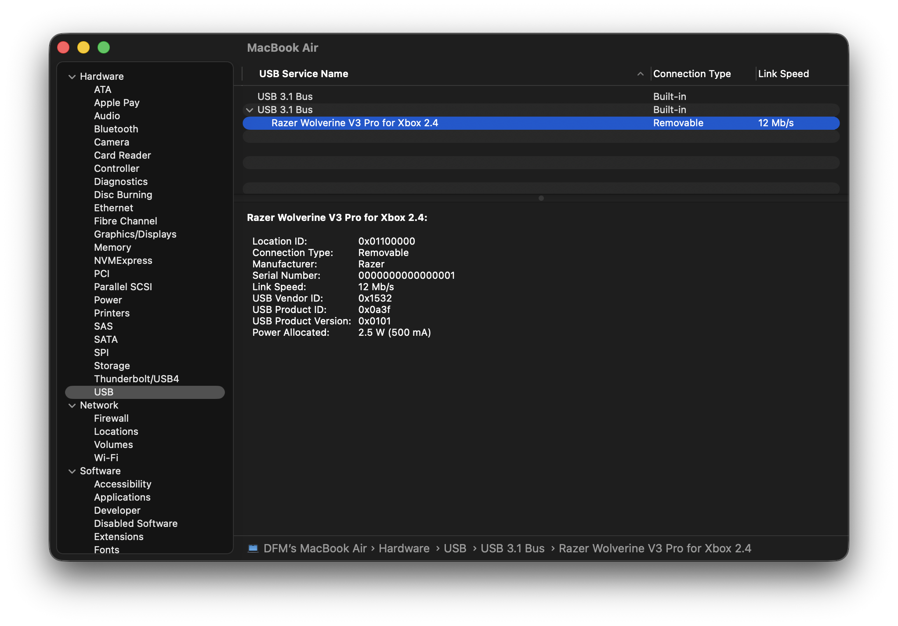

# Wolverine V3 Pro macOS Bridge

A macOS menu bar app that makes the Razer Wolverine V3 Pro appear to macOS as an Xbox Wireless Controller. Browsers, games, and other apps that use the system controller APIs can then use it, for example Chrome's Gamepad API and Xbox Cloud Gaming / Remote Play on xbox.com/play.

macOS attaches no driver to the Wolverine V3 Pro in Xbox mode. The controller speaks Microsoft's Gaming Input Protocol (GIP) on a vendor-class USB interface and sends no input until the host completes a security handshake. `WolverineBridge` does that handshake in userspace with libusb, decodes the input reports, and feeds them to a virtual HID gamepad created with CoreHID.

This project builds on [davefmurray/razer-wolverine-macos](https://github.com/davefmurray/razer-wolverine-macos). See [Credits](#credits).

## What works

Tested on an Apple Silicon Mac, macOS 27.2.1, Chrome 158, with the 2.4 GHz receiver, on 2026-11-27.

| Feature | Status |
| --- | --- |
| Virtual Xbox Wireless Controller (`045E:0B13`) | Working |
| Chrome Gamepad API | `mapping: "standard"`; sticks, triggers, buttons, and D-pad working |
| Rumble from the host | Working |
| xbox.com/play Remote Play | Working |
| Guide (Xbox) button | Sent by the bridge, but Chrome does not show it. See [BACKLOG.md](BACKLOG.md) |
| Wired USB | Not checked |
| M1–M6 paddles | Not exposed as separate buttons in Xbox mode |

The app runs in userspace. It needs no kernel extension, DriverKit installation, or SIP change. It does need a provisioning profile with the **HID Virtual Device** capability from the Apple Developer portal, so you build and sign it yourself. Only a paid Apple Developer Program membership has been tested.

## Requirements

- macOS 15 or later (CoreHID `HIDVirtualDevice`).
- Xcode or the Command Line Tools with Swift 6.
- Homebrew with `libusb` and `pkgconf`.
- An Apple Developer account, an Apple Development certificate in your keychain, and a macOS App Development provisioning profile for your own App ID. See [Create the provisioning profile](#create-the-provisioning-profile).
- The Wolverine V3 Pro in Xbox mode, USB identity `1532:0a3f`, over a USB data cable or the included 2.4 GHz HyperSpeed receiver. No Bluetooth pairing is needed.

## Get the source

```bash
brew install libusb pkgconf
git clone https://github.com/kromtom/wolverine-v3pro-macos-bridge.git
cd wolverine-v3pro-macos-bridge
```

## Create the provisioning profile

The bridge creates its virtual gamepad with CoreHID `HIDVirtualDevice`. That API needs the `com.apple.developer.hid.virtual.device` entitlement, which only a provisioning profile can grant. Without it, the app cannot create the virtual pad.

Do these steps once. Repeat them when the profile expires, after one year.

### 1. Make sure you have an Apple Development certificate

1. Open Xcode, then **Xcode → Settings → Accounts**.
2. Add your Apple ID if it is not listed, and select your team.
3. Click **Manage Certificates**. If no **Apple Development** certificate is listed, click **+** and select **Apple Development**.

Check that the certificate is in your keychain:

```bash
security find-identity -v -p codesigning | grep "Apple Development"
```

### 2. Register this Mac

1. Get this Mac's Provisioning UDID:

   ```bash
   system_profiler SPHardwareDataType | grep "Provisioning UDID"
   ```

2. Go to [Certificates, Identifiers & Profiles → Devices](https://developer.apple.com/account/resources/devices/list) and click **+**.
3. Select platform **macOS**, enter a device name, and paste the Provisioning UDID as the **Device ID (UUID)**.
4. Click **Continue**, then **Register**.

Skip this step if the Mac is already registered.

### 3. Create the App ID and request the capability

1. Go to [Identifiers](https://developer.apple.com/account/resources/identifiers/list) and click **+**.
2. Select **App IDs**, click **Continue**, select type **App**, and click **Continue**.
3. Enter a description, for example `Wolverine Bridge`.
4. Select **Explicit** and enter a bundle ID of your own, for example `com.<you>.wolverinebridge`. Do not use a wildcard App ID.
5. In the capability list, tick **HID Virtual Device (development)**. This is the capability that grants `com.apple.developer.hid.virtual.device`. No other capability is needed.
6. Click **Continue**, then **Register**.

### 4. Create and download the profile

1. Go to [Profiles](https://developer.apple.com/account/resources/profiles/list) and click **+**.
2. Under **Development**, select **macOS App Development** and click **Continue**.
3. Select the App ID from step 3 and click **Continue**.
4. Select your Apple Development certificate and click **Continue**.
5. Select this Mac and click **Continue**.
6. Enter the profile name `WolverineBridgeDev` and click **Generate**.
7. Click **Download**. The browser saves the file as `~/Downloads/WolverineBridgeDev.provisionprofile`.

If you enabled the capability after you created the profile, edit the profile and generate it again. An old profile does not get the new entitlement.

### 5. Copy the profile into the repository

Run these commands from the repository root (`wolverine-v3pro-macos-bridge`):

```bash
mkdir -p app/profiles
cp ~/Downloads/WolverineBridgeDev.provisionprofile app/profiles/development.provisionprofile
```

The build expects exactly `app/profiles/development.provisionprofile`. The `app/profiles/` folder is git-ignored, so the profile is never committed. To keep the profile somewhere else, pass `PROFILE=/path/to/file.provisionprofile` to `make`.

Check that the profile grants the entitlement:

```bash
security cms -D -i app/profiles/development.provisionprofile | grep -A1 hid.virtual.device
```

The output must contain `com.apple.developer.hid.virtual.device` followed by `<true/>`.

## Build and install

```bash
make install-bridge          # build, sign, copy to ~/Applications/WolverineBridge.app
open ~/Applications/WolverineBridge.app
```

The bundle ID is read from the profile's App ID. Set `BUNDLE_ID=...` only when the profile uses a wildcard App ID. The build script stops with an error if the profile is missing, has expired, or does not grant the entitlement. It warns if this Mac is not in the profile.

A controller icon appears in the menu bar. Connect the receiver or cable and switch on the controller. The menu shows the handshake state, then input counts. Tick **Start at Login** to start the bridge automatically.

See [app/README.md](app/README.md) for the menu, the terminal mode (`--cli`), the options, how to verify the virtual pad, and how the bridge recovers from a lost device or a stalled handshake.

## Find the receiver in macOS

Open **System Information**, select **Hardware → USB**, and select **Razer Wolverine V3 Pro for Xbox 2.4**.



Its vendor ID is `0x1532` and product ID is `0x0a3f`. USB detection alone does not prove that the controller is paired or sending input. The bridge's menu shows that.

## How it works

```text
Wolverine V3 Pro (USB cable or 2.4 GHz receiver, vendor class FF/47/D0 = GIP)
  -> src/core (libgipcore.a: libusb, GIP init sequence, security handshake, 0x20/0x07 decoding)
  -> WolverineBridge (Swift): GIP state -> Xbox Bluetooth HID report
  -> CoreHID HIDVirtualDevice "Xbox Wireless Controller" 045E:0B13
  -> IOHIDManager / GameController -> Chrome, games, other apps
```

The virtual device uses a Microsoft VID/PID and the Xbox Bluetooth firmware 5.x report descriptor, because Chrome applies the standard Gamepad mapping only to controllers it recognizes. Host rumble requests go back to the controller as GIP rumble commands.

## Limitations

- **Only one reader can use the controller at a time.** Quit the bridge, or use **Release USB Device** in its menu, before using `giptool` or another USB reader.
- The wireless handshake sometimes fails or stalls, especially after reconnects. The bridge closes and reopens the device to retry. The root cause is unknown.
- Closing the USB device makes macOS re-enumerate the controller, which takes about 2 s.
- Razer Synapse for Mac, if installed, publishes phantom virtual controllers `045E:028E` and `1532:27DB` that send no data. Do not mistake them for the bridge's pad.
- Certificates and development profiles expire yearly. Rebuild with a new profile when they do.

## Debug tool

`giptool` is a command-line reader over the same core. It is not used by the app, but it helps when you debug the handshake or the input reports.

```bash
make                          # builds build/libgipcore.a and build/giptool
./build/giptool               # live state; Ctrl-C quits
./build/giptool --json        # one JSON object per line
./build/giptool --raw | --query | --seconds N | --init meta,power,led,auth,rumble
make test-core                # core unit test with a fake libusb, no hardware
```

## Repository guide

| Path | Purpose |
| --- | --- |
| `app/` | Swift package: `WolverineBridge` menu bar app and the `XboxHID` report encoder. See [app/README.md](app/README.md) |
| `src/core/` | GIP host core (`gipcore.h`: libusb device, init sequence, input decoding; `gipauth.c`: security handshake), built as `build/libgipcore.a` |
| `src/giptool.c` | Command-line reader for debugging |
| `scripts/build-app.sh` | Build, bundle, and sign the app from your provisioning profile |
| `tests/` | Core unit test with a fake libusb and scripted device traffic |
| `web/gamepad.html` | Standalone page that shows what Chrome's Gamepad API sees |
| [BACKLOG.md](BACKLOG.md) | Open items |

## Credits

This repository started as a clone of [davefmurray/razer-wolverine-macos](https://github.com/davefmurray/razer-wolverine-macos) by davefmurray. That project provides the userspace GIP driver for the Wolverine V3 Pro on macOS: the libusb reader, the security handshake port, a browser input monitor, and a patched SDL2 for Wine. This repository keeps its GIP reader and handshake code, refactored into `src/core/`, and adds the virtual Xbox controller bridge app. The monitor and the Wine/SDL adapter were removed here; use the original repository for them.

The original project is itself based on [Tinerou/wolverine-v3-pro-macos-wine](https://github.com/Tinerou/wolverine-v3-pro-macos-wine). The authentication code is a userspace port of [medusalix/xone](https://github.com/medusalix/xone), using Apple's CommonCrypto and Security framework.

Protocol references include Microsoft's [MS-GIPUSB specification](https://learn.microsoft.com/en-us/openspecs/windows_protocols/ms-gipusb/), [medusalix/xone](https://github.com/medusalix/xone), Linux `xpad`, SDL's `SDL_hidapi_xboxone.c`, and [Netruk44/wolverine-v3-pro-linux](https://github.com/Netruk44/wolverine-v3-pro-linux).

## License

GPL-2.0-or-later, as in the original repository; required by the xone-derived authentication code. See [LICENSE](LICENSE). libusb is LGPL-2.1.

This project is not affiliated with Razer or Microsoft. Xbox is a trademark of Microsoft.
